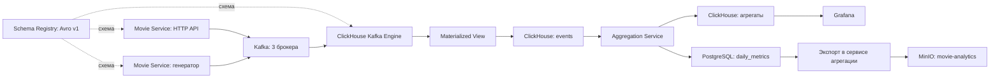

# ДЗ 5. Аналитика онлайн-кинотеатра

Pipeline на Python 3.12 и FastAPI: события попадают в Kafka, сохраняются в ClickHouse, затем отдельный сервис считает метрики и выгружает их в PostgreSQL. Grafana читает готовые агрегаты из ClickHouse, MinIO хранит JSON-выгрузки из PostgreSQL.

## Запуск

Нужны Docker с запущенным daemon и Docker Compose версии 2.24.4 или новее. Желательно выделить Docker 6 ГБ памяти. Для первой сборки нужен интернет. MinIO собирается из закреплённой версии исходников, поэтому первый запуск занимает заметно больше времени, чем следующие.

```bash
docker compose up
```

Команда `docker-compose up` тоже подходит, если установлен совместимый исполняемый файл Compose. Копировать `.env.example`, создавать топик, регистрировать схему или выполнять SQL вручную не требуется.

Для запуска в фоне:

```bash
docker compose up --build -d
docker compose ps
```

Контейнер `init` должен завершиться с кодом 0. Он создаёт топик, регистрирует Avro v1, применяет SQL и создаёт бакет. Остальные сервисы ждут его успешного завершения. Генератор сначала добавляет историю за 12 дней, затем создаёт текущие сессии. История нужна, чтобы сразу можно было показать retention. Первый расчёт начинается через 60 секунд после старта сервиса агрегации; если история ещё загружается, её подхватит следующий цикл.

| Что открыть | Адрес | Логин и пароль |
| --- | --- | --- |
| Movie Service, Swagger | http://localhost:8005/docs | не нужны |
| Aggregation Service, Swagger | http://localhost:8006/docs | не нужны |
| Grafana | http://localhost:3000/d/online-cinema | `admin` / `admin` |
| MinIO, просмотр объектов | http://localhost:9001 | `minioadmin` / `minioadmin123` |
| Schema Registry | http://localhost:8081/subjects | не нужны |
| ClickHouse HTTP | http://localhost:8123 | `cinema` / `cinema_pass` |
| PostgreSQL | `localhost:5432`, БД `cinema` | `cinema` / `cinema_pass` |

Порты опубликованы только на localhost. Пароли предназначены для локального учебного стенда. API использует порты 8005 и 8006, чтобы не конфликтовать с предыдущими домашними заданиями на порту 8000.

## Архитектура



`producer` и `generator` используют один модуль публикации, но запускаются в разных режимах. Агрегатор работает в своём контейнере и читает события только из ClickHouse. Он не потребляет Kafka.

## Что сделано по заданию

| Пункт | Реализация |
| --- | --- |
| 1. Топик и схема | `schemas/movie-event-v1.avsc`, `app/bootstrap.py`: 3 партиции, 3 реплики, Avro, subject `movie-events-value`, версия 1, `BACKWARD_TRANSITIVE` |
| 2. Продюсер | `app/producer/`: POST `/events`, валидация Pydantic и Avro, `acks=all`, idempotent producer, retry с backoff, генератор последовательностей |
| 3. Приём ClickHouse | `sql/clickhouse/001_schema.sql`: Kafka Engine, Materialized View, ReplacingMergeTree |
| 4. Тест pipeline | `tests/test_pipeline.py`: HTTP -> Kafka -> AvroConfluent -> ClickHouse с проверкой всех полей |
| 5. Агрегация и PostgreSQL | `app/aggregation/`, SQL в `sql/`: расписание, ручной пересчёт, DAU, среднее время, топ фильмов, конверсия, D1/D7, UPSERT |
| 6. Grafana | Автоматически создан datasource и дашборд: cohort heatmap Day 0..7, DAU, конверсия, среднее время и топ фильмов |
| 7. S3 | JSON из PostgreSQL, ключ `daily/YYYY-MM-DD/aggregates.json`, перезапись, очередь повторных экспортов |
| 8. Отказоустойчивость | 3 совмещённых broker/controller KRaft, RF=3, min ISR=2, health checks; тест с остановкой одного брокера |

## Событие и API

```json
{
  "event_id": "8b5120ae-0348-42d6-866d-eaa79cf601ad",
  "user_id": "user-42",
  "movie_id": "movie-01",
  "event_type": "VIEW_STARTED",
  "timestamp": "2026-11-16T12:00:00Z",
  "device_type": "TV",
  "session_id": "session-42",
  "progress_seconds": 0
}
```

POST `http://localhost:8005/events` принимает такой JSON. Успех: HTTP 201 и `event_id`, ошибка данных: 422, ошибка доставки: 503. Ответ 201 отправляется после подтверждения Kafka, а появление в ClickHouse происходит асинхронно. При 503 нужно повторить тот же запрос с тем же `event_id`.

В HTTP-запросе `event_id` можно не указывать, тогда API создаст UUID. В сообщении Kafka поле всегда присутствует. `timestamp` должен содержать часовой пояс и не быть в будущем. API приводит время к UTC и точности миллисекунд. Для `SEARCHED` разрешён пустой `movie_id`, прогресс равен 0. У `VIEW_STARTED` прогресс тоже равен 0. Отрицательный, дробный прогресс и неизвестные enum не принимаются.

Ключ Kafka: `user_id`. Действия одного пользователя попадают в одну партицию, даже если он меняет фильм. Это удобно для истории активности и retention. Порядок внутри партиции является порядком публикации, а не сортировкой по времени события. Несколько независимых источников должны сами согласовывать логический порядок своих событий.

Avro передаётся в формате Confluent: magic byte, четырёхбайтовый schema ID и бинарное содержимое. ClickHouse по schema ID получает контракт из Schema Registry. Версия внутри subject и глобальный schema ID являются разными понятиями.

## Метрики

Все даты считаются по UTC. События перед агрегацией читаются с `FINAL`.

| Метрика | Определение |
| --- | --- |
| `dau` | `uniqExact(user_id)` по всем событиям дня, включая поиск |
| `avg_watch_seconds` | `avgIf(progress_seconds, event_type = 'VIEW_FINISHED')` |
| `movie_views` | Число `VIEW_STARTED` по каждому фильму; Grafana выводит первые 10 |
| `conversion` | Количество `VIEW_FINISHED` / количество `VIEW_STARTED` за день |
| `retention_d1`, `retention_d7` | Доля пользователей когорты, активных ровно через 1 или 7 дней после первого `VIEW_STARTED` |
| `retention_day_0` ... `retention_day_7` | Те же значения по всем дням жизни для heatmap |
| `cohort_size` | Размер когорты по дате первого просмотра |
| `device_users` | Уникальные активные пользователи по устройству |

Возврат в retention означает любое событие пользователя в нужный день. Поиск до первого просмотра не создаёт когорту, пользователь только с поисками в неё не входит. В метрике retention дата строки обозначает дату когорты. В DAU и конверсии это дата активности.

Day 0 равен 100% для непустой когорты. Дни жизни, которые ещё не завершились по UTC, записываются как `NULL`, а не 0. У пустой когорты retention тоже `NULL`. Для среднего времени без завершённых просмотров и конверсии без начатых просмотров используется `NULL`.

Конверсия здесь считается буквально по заданию, по событиям одного календарного дня. Она может превышать 100%, если в этот день завершились просмотры, начатые раньше. Это не конверсия связанных сессий. Среднее время также соответствует заданию: средний финальный progress, а не сумма времени между паузами.

SQL retention сначала находит первый просмотр каждого пользователя за всю историю, затем собирает его дни активности и разворачивает Day 0..7 через `ARRAY JOIN range(8)`. Используются `min`, `groupUniqArray`, `countIf`, `avgIf`, `uniqExact`.

## Хранение, повторы и пересчёт

Raw-события лежат в `cinema.events`: партиции по месяцу, сортировка `(toDate(timestamp), user_id, event_id)`. ReplacingMergeTree схлопывает повторную доставку. `FINAL` нужен, чтобы результаты не зависели от того, успело ли пройти фоновое слияние. Контракт предполагает неизменяемое событие: повтор с тем же UUID должен иметь те же данные, в частности пользователя и дату.

Агрегаты физически сохраняются в `cinema.metric_snapshots`. Расчёт получает новую версию. Только после успешной записи результатов в PostgreSQL в `cinema.aggregation_runs` появляется отметка завершения. Представление `cinema.daily_metrics` показывает последнюю завершённую версию каждой даты. Так Grafana не видит половину нового набора и устаревшие измерения из прошлого расчёта. Повтор вставки одного snapshot также схлопывается через ReplacingMergeTree и `FINAL`.

В PostgreSQL ключ `(metric_date, metric_name, dimension)`, запись через `ON CONFLICT DO UPDATE`. Поля: дата, имя метрики, измерение, значение и время вычисления. Обновление метрик и постановка экспорта в очередь происходят в одной транзакции.

Общей транзакции между ClickHouse и PostgreSQL нет. При сбое возможен короткий промежуток, когда PostgreSQL уже обновился, а ClickHouse ещё показывает прошлый завершённый snapshot. Повторный расчёт приводит их к одному состоянию. В проекте один процесс агрегатора; ручной запуск и scheduler защищены общим lock.

По умолчанию каждые 60 секунд пересчитываются сегодня и предыдущие 14 дней. Это обновляет ещё не созревший retention и учитывает опоздавшие события. Интервал отсчитывается после завершения цикла, пересекающихся циклов нет. Данные старше окна пересчитываются через HTTP вручную. Для позднего первого просмотра нужно пересчитать и прежнюю, и новую дату когорты, если они находятся вне окна.

```bash
curl -X POST 'http://localhost:8006/recalculate?date=2026-11-16'
curl -X POST 'http://localhost:8006/export?date=2026-11-16'
```

## Экспорт

После пересчёта появляется или обновляется строка `export_jobs`. Scheduler обрабатывает очередь для всех завершённых календарных дней. Таким образом, вчерашний день выгружается автоматически, поздний пересчёт обновляет файл, а старые неудачные экспорты не теряются при перезапуске.

Экспорт читает `daily_metrics` именно из PostgreSQL. JSON содержит все метрики за дату, включая измерения фильмов и устройств, дату и время вычисления. Путь:

```text
s3://movie-analytics/daily/2026-11-16/aggregates.json
```

Повторный PUT по тому же ключу заменяет объект. При недоступности PostgreSQL или S3 есть ограниченный retry, сообщение в логе, затем повтор на следующем цикле. Статус очереди можно посмотреть в `export_jobs`. Ручной экспорт даты без рассчитанных метрик вернёт 404.

## Проверка и демонстрация

Все автоматические тесты, включая остановку брокера:

```bash
./scripts/test.sh
```

Скрипт сам собирает и поднимает изолированный Compose-проект с отдельными volumes. Генератор и scheduler в нём выключены, наружные порты не публикуются. После тестов удаляются только контейнеры и данные этого тестового проекта. Обычный стенд остаётся на месте. Для одновременного запуска двух стеков потребуется больше памяти.

Проверяются контракт, репликация, все поля события, некорректные HTTP-запросы, дубликаты, точные значения бизнес-метрик, созревание retention, поздняя доставка, повторный пересчёт, содержимое S3 и реальные запросы всех панелей через API Grafana. Затем останавливается `kafka-1`, и новые события должны пройти до ClickHouse через оставшиеся брокеры. Также проверяется сбой MinIO: ошибка остаётся в очереди, а после восстановления следующий запуск обработчика успешно экспортирует данные. Тесты запускаются и в GitHub Actions.

Небольшой сценарий для запущенного обычного стенда:

```bash
python3 scripts/demo.py
```

Он отправит начало и конец просмотра за вчера, дождётся ClickHouse, вызовет пересчёт и экспорт. Нужен только Python 3, сторонние пакеты локально не устанавливаются.

Полезные команды:

```bash
docker compose logs -f producer aggregation
docker compose exec kafka-1 kafka-topics --bootstrap-server kafka-2:9092 --describe --topic movie-events
docker compose exec clickhouse clickhouse-client --user cinema --password cinema_pass --query 'SELECT count() FROM cinema.events FINAL'
docker compose exec postgres psql -U cinema -d cinema -c 'SELECT * FROM daily_metrics ORDER BY metric_date DESC, metric_name LIMIT 30;'
docker compose down
```

`docker compose down` сохраняет данные. Команда `docker compose down -v` полностью удалит данные этого стенда, включая историю и экспортированные файлы.

## Настройки

Параметры можно задать в `.env` по примеру `.env.example` или перед командой запуска.

| Переменная | По умолчанию | Для чего |
| --- | --- | --- |
| `AGGREGATION_INTERVAL_SECONDS` | `60` | Интервал между циклами расчёта и экспорта |
| `RECALCULATE_DAYS` | `14` | Число прошлых дней в окне; минимум 8 |
| `GENERATOR_ENABLED` | `true` | Поток синтетических событий |
| `SEED_HISTORY` | `true` | История при первом запуске |
| `GENERATOR_INTERVAL_SECONDS` | `3` | Интервал создания новых сессий |
| `SCHEDULER_ENABLED` | `true` | Автоматические циклы агрегатора |
| `PRODUCER_PORT`, `AGGREGATION_PORT` | `8005`, `8006` | Порты HTTP API на компьютере |

## Ограничения учебного решения

Репликация настроена для Kafka. PostgreSQL, ClickHouse и MinIO работают по одному экземпляру. В продакшене потребовались бы их репликация, резервное копирование, управление секретами, авторизация API и мониторинг. Kafka в режиме combined KRaft подходит для этого локального стенда. Один брокер можно потерять, два одновременно нельзя: не останется кворума и необходимого ISR.

Приём из Kafka имеет семантику at-least-once. Идемпотентный producer не делает весь pipeline exactly-once, поэтому дополнительно используются дедупликация событий и идемпотентные пересчёты. SQL retention сканирует историю: это понятно для домашнего задания, но на больших объёмах понадобилась бы отдельная таблица первых просмотров. Старые версии агрегатов пока сохраняются для разбора пересчётов.

Подробное объяснение для защиты: [docs/DEFENSE.txt](docs/DEFENSE.txt).

## Документация, использованная при настройке

- [ClickHouse: AvroConfluent](https://clickhouse.com/docs/reference/formats/Avro/AvroConfluent)
- [Confluent: Docker и KRaft](https://docs.confluent.io/platform/7.8/installation/docker/config-reference.html)
- [Confluent: формат сообщений Schema Registry](https://docs.confluent.io/platform/current/schema-registry/fundamentals/serdes-develop/index.html)
- [Grafana: конфигурация ClickHouse datasource](https://grafana.com/docs/plugins/grafana-clickhouse-datasource/latest/configure/)
- [MinIO: сборка Community Edition из исходников](https://github.com/minio/minio)
